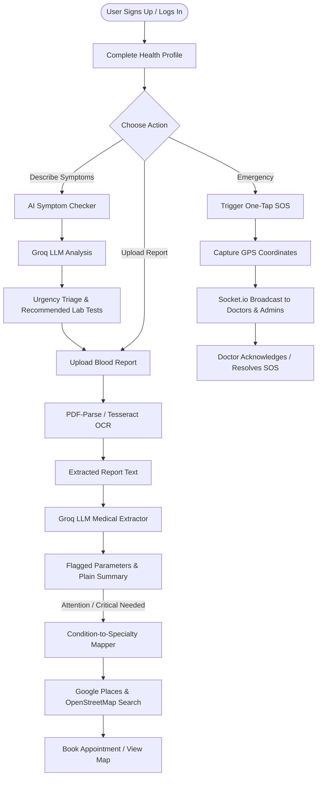

# 🏥 HealthAI Next — AI-Assisted Clinical Triage, Lab Diagnostics & Emergency Health Platform

> **HealthAI Next** is an end-to-end, AI-powered healthcare assistant built with the **MERN** stack (MongoDB, Express.js, React, Node.js), powered by **Groq High-Speed LLM Inference**, **Google Places API (New)**, **OpenStreetMap Nominatim**, and **Socket.io** real-time communications.

[](LICENSE)
[](https://nodejs.org/)
[](https://react.dev/)
[](https://groq.com/)
[](https://socket.io/)

---

## 📌 Table of Contents

1. [Executive Summary & Abstract](#-executive-summary--abstract)
2. [End-to-End Workflow](#-end-to-end-workflow)
3. [System Architecture](#-system-architecture)
4. [Exhaustive API Catalog](#-exhaustive-api-catalog)
   - [4.1 External Third-Party APIs](#41-external-third-party-apis)
   - [4.2 Internal REST API Endpoints](#42-internal-rest-api-endpoints)
   - [4.3 Real-Time WebSocket API (Socket.io)](#43-real-time-websocket-api-socketio)
5. [OCR & Document Processing Engine](#-ocr--document-processing-engine)
6. [Database Schema & Data Dictionary](#-database-schema--data-dictionary)
7. [Frontend Design & UI Pages](#-frontend-design--ui-pages)
8. [Tech Stack Breakdown](#-tech-stack-breakdown)
9. [Project Directory Structure](#-project-directory-structure)
10. [Environment Variables & Configuration](#-environment-variables--configuration)
11. [Installation & Local Setup](#-installation--local-setup)
12. [Security & Compliance](#-security--compliance)
13. [Medical Disclaimer](#-medical-disclaimer)

---

## 📖 Executive Summary & Abstract

Traditional healthcare journeys are fragmented: patients search symptoms online and receive alarming, inaccurate information; lab reports are written in medical jargon that patients cannot interpret without an appointment; and in emergencies, notifying responders with live geolocation is slow and disconnected.

**HealthAI Next** bridges this gap by providing an intelligent, unified digital clinic companion:
- **AI Symptom Checker:** Accepts plain-language descriptions of ailments, estimates clinical urgency (`routine`, `soon`, `urgent`), lists possible conditions, and recommends specific diagnostic lab tests.
- **Smart Blood Report Interpreter:** Users upload lab reports as **PDF**, scanned **Images (JPEG/PNG)**, or plain text. The system extracts text using OCR, identifies clinical parameters (e.g., Hemoglobin, Glucose, Creatinine, TSH), compares them to standard medical reference intervals, flags abnormalities (`low`, `high`, `critical`), and generates a plain-language patient summary.
- **Doctor & Hospital Finder:** Automatically maps detected medical anomalies or symptoms to the relevant clinical specialty (e.g., Anemia $\rightarrow$ Hematologist; Glucose/HbA1c $\rightarrow$ Endocrinologist; Creatinine $\rightarrow$ Nephrologist) and discovers nearby rated clinics/doctors using the Google Places API and OpenStreetMap Nominatim.
- **Real-Time Emergency SOS System:** Patients in distress can broadcast an instant SOS with their live GPS coordinates over authenticated WebSockets to registered doctors and administrators.
- **Unified Health Record Dashboard:** Patients track past checks, review historical lab reports, and manage appointment bookings in one place.

---

## 🔄 End-to-End Workflow



---

## 🏗 System Architecture

HealthAI Next employs a decoupled, client-server architecture:

```
[ Browser / Client (React 19 + Vite) ]
         │               ▲
         │ (HTTP / JSON) │ (WebSocket / Socket.io)
         ▼               ▼
[ Express.js 4.x Backend Gateway (Port 5000) ]
    ├── Helmet Security & CORS Middleware
    ├── JWT Authentication & Role Authorization (patient | doctor | admin)
    ├── Multer File Storage & Pipeline
    ├── Tesseract.js (Local OCR) & PDF-Parse
    ├── In-Memory TTL Cache (Google Places queries)
    │
    ├──► [ Groq Cloud AI Engine ] (LLM Inference: openai/gpt-oss-20b)
    ├──► [ Google Places API (New) ] (Text Search & Geolocation Bias)
    ├──► [ OpenStreetMap Nominatim ] (Free Hospital Lookup)
    └──► [ MongoDB Database ] (Mongoose Models: User, Report, Symptom, Appointment, SOS)
```

---

## 🔌 Exhaustive API Catalog

### 4.1 External Third-Party APIs

| Service | Protocol / Base URL | Purpose in HealthAI Next | Implementation Details |
|---|---|---|---|
| **Groq Cloud AI API** | HTTPS (`https://api.groq.com/openai/v1`) | Powers natural language symptom analysis and structured blood report interpretation | Integrated via `openai` Node.js SDK with OpenAI-compatible endpoint. Utilizes `openai/gpt-oss-20b` with `response_format: { type: "json_object" }` for deterministic JSON outputs. |
| **Google Places API (New)** | HTTPS POST (`https://places.googleapis.com/v1/places:searchText`) | Searches verified clinics, hospitals, and specialists based on medical conditions | Uses field masking (`X-Goog-FieldMask`), 10km circle radius geolocation biasing (`locationBias`), and in-memory TTL caching (1 hour) to reduce redundant API quota calls. |
| **OpenStreetMap Nominatim** | HTTPS GET (`https://nominatim.openstreetmap.org/search`) | Provides keyless, free geospatial hospital and clinic lookup on the frontend | Query: `q=hospital+<location>&format=json&addressdetails=1&limit=10`. Used directly from the client with custom User-Agent headers. |
| **HTML5 Browser Geolocation API** | Native Web API (`navigator.geolocation`) | Captures device latitude & longitude | Used for location-based doctor matching and embedding exact coordinates into Emergency SOS alerts. |

---

### 4.2 Internal REST API Endpoints

All protected routes require an `Authorization: Bearer <JWT>` header.

#### 🔐 Authentication & Profile (`/auth`, `/api/profile`)
| Method | Endpoint | Auth | Description | Payload / Response |
|---|---|---|---|---|
| `POST` | `/auth/register` | Public | Create new patient or doctor account | **Body:** `{ name, email, password, age, sex, phone, role }`<br>**Returns:** `{ message, token, user }` |
| `POST` | `/auth/login` | Public | Authenticate user & issue JWT | **Body:** `{ email, password }`<br>**Returns:** `{ message, token, user }` |
| `GET` | `/api/profile` | Bearer | Retrieve logged-in user profile | **Returns:** `{ user: { name, email, age, sex, medicalHistory, ... } }` |
| `PUT` | `/api/profile` | Bearer | Update user profile, emergency contact, history | **Body:** `{ name, age, phone, bloodGroup, emergencyContact, medicalHistory }` |

#### 🩺 Symptom Checker (`/api/symptoms`)
| Method | Endpoint | Auth | Description | Payload / Response |
|---|---|---|---|---|
| `POST` | `/api/symptoms` | Bearer | Submit natural language symptom description | **Body:** `{ description: "High fever and fatigue for 2 days..." }`<br>**Returns:** `{ symptomCheck: { possibleConditions, recommendedTests, urgency } }` |
| `GET` | `/api/symptoms/history` | Bearer | Paginated history of user's past symptom checks | **Query:** `?page=1&limit=10`<br>**Returns:** `{ checks: [...], pagination: { ... } }` |

#### 🧪 Blood Reports & AI Diagnostics (`/api/reports`)
| Method | Endpoint | Auth | Description | Payload / Response |
|---|---|---|---|---|
| `POST` | `/api/reports/upload` | Bearer | Upload report via multipart form or raw text | **Multipart Body:** `report` (file: PDF/JPG/PNG) OR **JSON:** `{ rawText, symptomCheckId }`<br>**Returns:** `{ reportId, fileType, extractedTextLength }` |
| `POST` | `/api/reports/:id/analyze` | Bearer | Run Groq AI analysis on extracted report text | **Returns:** `{ report: { documentName, analysis: { status, findings, summary } } }` |
| `GET` | `/api/reports/:id` | Bearer | Retrieve full report details and analysis results | **Returns:** `{ report: { _id, documentName, analysis, createdAt, ... } }` |
| `GET` | `/api/reports` | Bearer | Paginated list of uploaded reports | **Query:** `?page=1&limit=10`<br>**Returns:** `{ reports: [...], pagination: { ... } }` |

#### 👨‍⚕️ Doctor & Clinic Search (`/api/doctors`)
| Method | Endpoint | Auth | Description | Payload / Response |
|---|---|---|---|---|
| `POST` | `/api/doctors/nearby` | Bearer | Query Google Places API for specialist doctors | **Body:** `{ condition: "anemia", city: "Vadodara", lat: 22.3072, lng: 73.1812 }`<br>**Returns:** `{ count: 10, doctors: [{ name, address, phone, rating, mapsUrl }] }` |

#### 📅 Appointments (`/api/appointments`)
| Method | Endpoint | Auth | Description | Payload / Response |
|---|---|---|---|---|
| `GET` | `/api/appointments` | Bearer | Get user appointments with optional status filter | **Query:** `?page=1&limit=10&status=confirmed`<br>**Returns:** `{ appointments: [...] }` |
| `POST` | `/api/appointments` | Bearer | Book an appointment with a clinic snapshot | **Body:** `{ date, placeId, placeName, specialty, address, phone, notes }` |

#### 💓 Health Check
| Method | Endpoint | Auth | Description | Response |
|---|---|---|---|---|
| `GET` | `/api/health` | Public | Server liveness check | `{ status: "ok", timestamp: "..." }` |

---

### 4.3 Real-Time WebSocket API (Socket.io)

HealthAI Next runs a dedicated, authenticated Socket.io namespace at `/emergency` for life-critical SOS dispatching.

```
Patient Client                          Socket Server                     Doctor / Admin Clients
      │                                       │                                     │
      │── [Connect with JWT Token] ──────────►│                                     │
      │                                       │◄── [Connect with JWT Token] ────────│
      │                                       │    (Joins 'role:doctor' room)       │
      │                                       │                                     │
      │── emit('sos:trigger', {lat, lng}) ───►│                                     │
      │                                       │── emit('sos:incoming', sosData) ───►│
      │◄── ack('Help is on the way') ─────────│                                     │
      │                                       │                                     │
      │                                       │◄── emit('sos:acknowledge', {sosId})─│
      │◄── emit('sos:status-update') ─────────│── emit('sos:updated') ─────────────►│
      │    ('Acknowledged by Dr. Smith')      │                                     │
```

#### Socket Events Reference:

| Event Name | Direction | Sender | Description |
|---|---|---|---|
| `connection` | Both | System | Authenticates socket connection using JWT query/auth token and joins role rooms (`role:patient`, `role:doctor`, `role:admin`, `user:<id>`). |
| `sos:trigger` | Client $\rightarrow$ Server | Patient | Initiates emergency SOS with GPS coordinates `{ lat, lng, message }`. |
| `sos:incoming` | Server $\rightarrow$ Client | Server Broadcast | Broadcasts urgent alert to all connected doctors and admins with patient info and location. |
| `sos:acknowledge` | Client $\rightarrow$ Server | Doctor / Admin | Doctor claims responsibility for the emergency. |
| `sos:status-update` | Server $\rightarrow$ Client | Server to Patient | Updates the affected patient on responder status (e.g. "Acknowledged by Dr. Sharma"). |
| `sos:resolve` | Client $\rightarrow$ Server | Doctor / Admin | Marks emergency as resolved and logs resolution timestamp. |
| `sos:get-active` | Client $\rightarrow$ Server | Any role | Fetches all currently active/acknowledged alerts. |
| `sos:active-list` | Server $\rightarrow$ Client | Server response | Sends active alerts list to requesting client. |

---

## 🔬 OCR & Document Processing Engine

HealthAI Next processes laboratory diagnostic reports through a multi-stage ingestion pipeline:

1. **File Upload Handling (`multer`):**
   - Stores files in `server/uploads/` with sanitized, collision-resistant timestamps.
   - Enforces a 10MB file limit and MIME validation (`application/pdf`, `image/jpeg`, `image/png`).
2. **Digital PDF Parsing (`pdf-parse`):**
   - Reads digital PDF stream buffers and parses native text elements directly into raw string data.
3. **Scanned Image OCR (`tesseract.js`):**
   - Utilizes English OCR training data (`eng.traineddata`) with neural OCR workers to recognize text from scanned physical printouts or phone photos.
4. **Clinical Normalization with Groq LLM:**
   - The extracted unstructured text is passed into a constrained clinical prompt that extracts:
     - `parameter`: Test name (e.g., Hemoglobin, Serum Creatinine)
     - `value`: Numerical measurement and unit (e.g., 9.2 g/dL)
     - `normalRange`: Standard adult reference interval (e.g., 12.0 - 15.5 g/dL)
     - `flag`: Normalized condition (`normal`, `low`, `high`, `critical`)
     - `explanation`: Plain-language medical reasoning for the patient.

---

## 🗄 Database Schema & Data Dictionary

The application runs on MongoDB with five primary Mongoose schemas:

```
┌──────────────┐         1:N         ┌──────────────────┐
│     User     │────────────────────<│   SymptomCheck   │
└──────────────┘                     └──────────────────┘
       │
       │ 1:N                         1:N
       ├────────────────────────────<┌──────────────────┐
       │                             │   BloodReport    │
       │ 1:N                         └──────────────────┘
       ├────────────────────────────<┌──────────────────┐
       │                             │   Appointment    │
       │ 1:N                         └──────────────────┘
       └────────────────────────────<┌──────────────────┐
                                     │      SosLog      │
                                     └──────────────────┘
```

### 1. `User` Schema (`models/User.js`)
- `name`: String (Required, trimmed)
- `email`: String (Required, unique, lowercase)
- `passwordHash`: String (Bcrypt salted hash)
- `role`: Enum `['patient', 'doctor', 'admin']` (Default: `'patient'`)
- `age`: Number
- `sex`: Enum `['male', 'female', 'other']`
- `phone`: String
- `bloodGroup`: Enum `['A+', 'A-', 'B+', 'B-', 'AB+', 'AB-', 'O+', 'O-']`
- `emergencyContact`: `{ name, phone, relation }`
- `medicalHistory`: `{ allergies: [String], chronicConditions: [String], currentMedications: [String] }`
- `timestamps`: `createdAt`, `updatedAt`

### 2. `SymptomCheck` Schema (`models/SymptomCheck.js`)
- `userId`: ObjectId (Ref: `User`)
- `description`: String (Min 10, max 2000 chars)
- `aiResponse`:
  - `possibleConditions`: `[String]`
  - `recommendedTests`: `[{ test: String, reason: String }]`
  - `urgency`: Enum `['routine', 'soon', 'urgent']`
- `timestamps`: `createdAt`, `updatedAt`

### 3. `BloodReport` Schema (`models/BloodReport.js`)
- `userId`: ObjectId (Ref: `User`)
- `documentName`: String (e.g., "Complete Blood Count", "Thyroid Profile")
- `fileUrl`: String (Path to uploaded file)
- `rawText`: String
- `extractedText`: String (Text obtained via OCR or PDF parser)
- `fileType`: Enum `['pdf', 'image', 'text']`
- `originalFilename`: String
- `symptomCheckId`: ObjectId (Optional link to preceding symptom check)
- `analysis`:
  - `status`: Enum `['pending', 'normal', 'attention', 'error']`
  - `findings`: `[{ parameter, value, normalRange, flag, explanation }]`
  - `summary`: String (2-3 plain-language sentences)
  - `analyzedAt`: Date
- `timestamps`: `createdAt`, `updatedAt`

### 4. `Appointment` Schema (`models/Appointment.js`)
- `userId`: ObjectId (Ref: `User`)
- `placeId`: String (Google Places / Provider ID)
- `placeName`: String
- `specialty`: String
- `address`: String
- `phone`: String
- `date`: Date
- `status`: Enum `['pending', 'confirmed', 'completed', 'cancelled']`
- `notes`: String
- `timestamps`: `createdAt`, `updatedAt`

### 5. `SosLog` Schema (`models/SosLog.js`)
- `userId`: ObjectId (Ref: `User`)
- `status`: Enum `['active', 'acknowledged', 'resolved']`
- `location`: `{ lat: Number, lng: Number }`
- `message`: String
- `acknowledgedBy`: ObjectId (Ref: `User`)
- `acknowledgedAt`: Date
- `resolvedAt`: Date
- `timestamps`: `createdAt`, `updatedAt`

---

## 🎨 Frontend Design & UI Pages

The client is crafted with **React 19**, **Tailwind CSS v4**, and **Lucide React**, incorporating accessible, modern healthcare design principles (clean serif typography, calm teal and warm paper palettes, status badges, and subtle EKG heart rate animations).

| Page Component | Route | Functionality |
|---|---|---|
| **Onboarding** | `/register` | Split-screen registration capturing personal, demographic, and medical details |
| **Login** | `/login` | Secure JWT authentication with role redirection |
| **Dashboard** | `/dashboard` | Central health overview: quick actions, recent reports, symptom check history, upcoming appointments |
| **SymptomChecker** | `/symptoms` | Interactive consultation form with urgency triage badges, condition tags, and test recommendations |
| **ReportUpload** | `/upload` | Drag-and-drop file uploader (PDF/Image) or raw text input with live OCR status |
| **ReportResult** | `/reports/:id/result` | Visual lab parameters table, color-coded abnormality badges (Low/High/Critical), and 1-click specialist search |
| **FindDoctor** | `/find-doctor` | Interactive medical facility search powered by OpenStreetMap Nominatim and Google Places |
| **Emergency** | `/emergency` | Real-time SOS dispatch console with live GPS telemetry, pulse status indicator, and responder dashboard |

---

## 🛠 Tech Stack Breakdown

### Frontend:
- **React 19** — Next-generation functional UI library
- **Vite 8** — Ultra-fast frontend bundler and HMR dev server
- **Tailwind CSS v4** — Modern utility styling engine
- **React Router DOM 7** — Client-side declarative routing and protected routes
- **Axios** — HTTP client with bearer token request interceptors
- **Socket.io Client** — Real-time emergency connection
- **Lucide React** — Medical and operational icon suite

### Backend:
- **Node.js 20+** — Server-side JavaScript runtime
- **Express.js 4.21** — RESTful HTTP routing framework
- **Socket.io 4.8** — Bi-directional WebSocket server
- **MongoDB & Mongoose 8.9** — Schematized document database
- **JWT & Bcrypt.js** — Secure token encryption and password hashing
- **Helmet & CORS** — HTTP security headers and cross-origin controls
- **Multer 1.4** — Streaming file upload management
- **Zod 3.24** — Strict runtime schema validation for incoming requests
- **Tesseract.js 5.1 & PDF-Parse 1.1** — In-process OCR and PDF extraction engine
- **OpenAI SDK 4.77** — Configured for Groq Cloud LLM completion endpoints

---

## 📁 Project Directory Structure

```
healthai-next/
├── client/                              # Frontend React Application
│   ├── public/                          # Static assets and icons
│   ├── src/
│   │   ├── api/
│   │   │   ├── axios.js                 # Axios instance with auth interceptor
│   │   │   └── endpoints.js             # Centralized API service functions
│   │   ├── components/
│   │   │   ├── LoadingSpinner.jsx       # Universal loading state
│   │   │   ├── MedicalDisclaimer.jsx    # Clinical compliance disclaimer
│   │   │   ├── Navbar.jsx               # Navigation bar with role support
│   │   │   └── ProtectedRoute.jsx       # Route guard for authenticated users
│   │   ├── context/
│   │   │   └── AuthContext.jsx          # JWT token and session provider
│   │   ├── pages/
│   │   │   ├── Dashboard.jsx            # User health hub
│   │   │   ├── Emergency.jsx            # Real-time SOS console
│   │   │   ├── FindDoctor.jsx           # Location-based hospital search
│   │   │   ├── Login.jsx                # User login page
│   │   │   ├── Onboarding.jsx           # Patient registration page
│   │   │   ├── ReportResult.jsx         # AI lab analysis breakdown
│   │   │   ├── ReportUpload.jsx         # Multi-format report upload
│   │   │   └── SymptomChecker.jsx       # AI symptom triage interface
│   │   ├── App.jsx                      # Routing layout and provider root
│   │   ├── index.css                    # Design tokens and custom styles
│   │   └── main.jsx                     # Vite DOM entrypoint
│   ├── package.json
│   └── vite.config.js
│
└── server/                              # Backend Express Application
    ├── config/
    │   └── db.js                        # MongoDB Mongoose connection
    ├── middleware/
    │   ├── auth.js                      # JWT verification & role authorization
    │   └── upload.js                    # Multer disk storage and file filter
    ├── models/
    │   ├── Appointment.js               # Appointment schema
    │   ├── BloodReport.js               # Report and AI findings schema
    │   ├── SosLog.js                    # Emergency alert logs schema
    │   ├── SymptomCheck.js              # Symptom check session schema
    │   └── User.js                      # User profile & credentials schema
    ├── routes/
    │   ├── appointment.routes.js        # /api/appointments
    │   ├── auth.routes.js               # /auth
    │   ├── doctor.routes.js             # /api/doctors
    │   ├── profile.routes.js            # /api/profile
    │   ├── report.routes.js             # /api/reports
    │   └── symptom.routes.js            # /api/symptoms
    ├── services/
    │   ├── ai/
    │   │   ├── reportService.js         # Lab report interpretation via Groq
    │   │   └── symptomService.js        # Symptom triage via Groq
    │   └── placesService.js             # Google Places API integration & caching
    ├── sockets/
    │   └── emergency.js                 # Socket.io /emergency namespace handler
    ├── uploads/                         # Storage directory for uploaded reports
    ├── eng.traineddata                  # Offline Tesseract OCR English model
    ├── package.json
    └── server.js                        # HTTP + WebSocket server entrypoint
```

---

## ⚙️ Environment Variables & Configuration

### Server Configuration (`server/.env`)

```ini
# Database Connection
MONGO_URI=mongodb://localhost:27017/healthai-next

# Security & Authentication
JWT_SECRET=your_super_secret_jwt_random_key_here

# Groq Cloud AI API (https://console.groq.com/keys)
GROQ_API_KEY=gsk_your_groq_api_key_here

# Google Cloud Places API (New)
GOOGLE_PLACES_API_KEY=AIzaSy_your_google_places_api_key_here

# Network Configuration
PORT=5000
CLIENT_URL=http://localhost:5173
```

### Client Configuration (`client/.env`)

```ini
# Backend API Base URL
VITE_API_URL=http://localhost:5000
```

---

## 🚀 Installation & Local Setup

### 1. Prerequisites
- **Node.js** v20.x or higher installed
- **MongoDB** running locally (`mongod`) or cloud connection URI (MongoDB Atlas)
- Free API keys from **Groq Console** and **Google Cloud Console**

### 2. Clone the Repository
```bash
git clone https://github.com/Vedant1274/Health-AI.git
cd Health-AI/healthai-next
```

### 3. Server Setup & Start
```bash
cd server

# Copy environment template
cp .env.example .env
# Edit .env with your MongoDB URI, Groq Key, and Google Places Key

# Install dependencies
npm install

# Start development server (auto-reloads on file change)
npm run dev
```
*Server will start listening on `http://localhost:5000` and establish Socket.io listeners.*

### 4. Client Setup & Start
In a new terminal window:
```bash
cd client

# Copy environment template
cp .env.example .env

# Install dependencies
npm install

# Start Vite dev server
npm run dev
```
*Frontend will be accessible at `http://localhost:5173`.*

---

## 🛡 Security & Compliance

1. **Authentication Security:** Passwords are encrypted using `bcryptjs` with salt rounds. Tokens are issued via stateless `jsonwebtoken` (JWT) containing user ID and role claims.
2. **Input Validation:** API routes enforce strict schema checking using `zod` to prevent malformed payloads, injection, and invalid field formats.
3. **HTTP Header Hardening:** `helmet` is active across all Express routes to secure against common web vulnerabilities (XSS, clickjacking, MIME sniffing).
4. **CORS Restrictions:** Cross-Origin Resource Sharing is locked down to authorized client URLs (`CLIENT_URL`).
5. **Upload Protection:** File uploads are restricted by MIME type (only PDF, JPEG, PNG allowed), size-limited to 10MB, and assigned randomized, sanitized server file names.

---

## ⚕️ Medical Disclaimer

> **IMPORTANT MEDICAL NOTICE:**  
> **HealthAI Next** is an assistive software tool designed for informational and educational purposes only. It is **not** a certified medical device and **does not** provide definitive medical diagnoses, clinical prescriptions, or healthcare treatment plans.
>
> All AI-generated analyses, test suggestions, and parameter flags should always be verified by a licensed medical practitioner. If you or someone around you is facing a severe health crisis, chest pain, difficulty breathing, or severe bleeding, immediately call local emergency services (e.g., 108 / 112) or visit the nearest emergency room.
